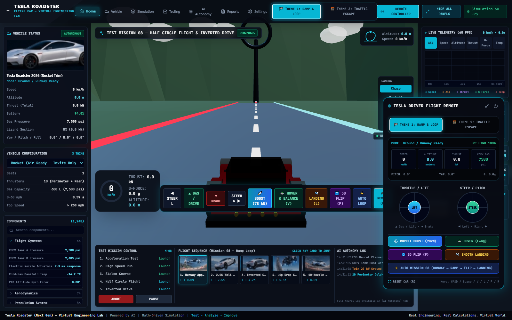
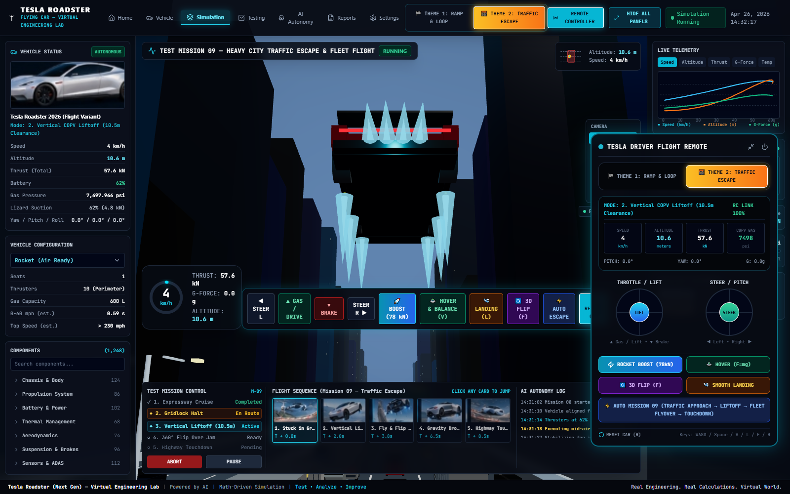
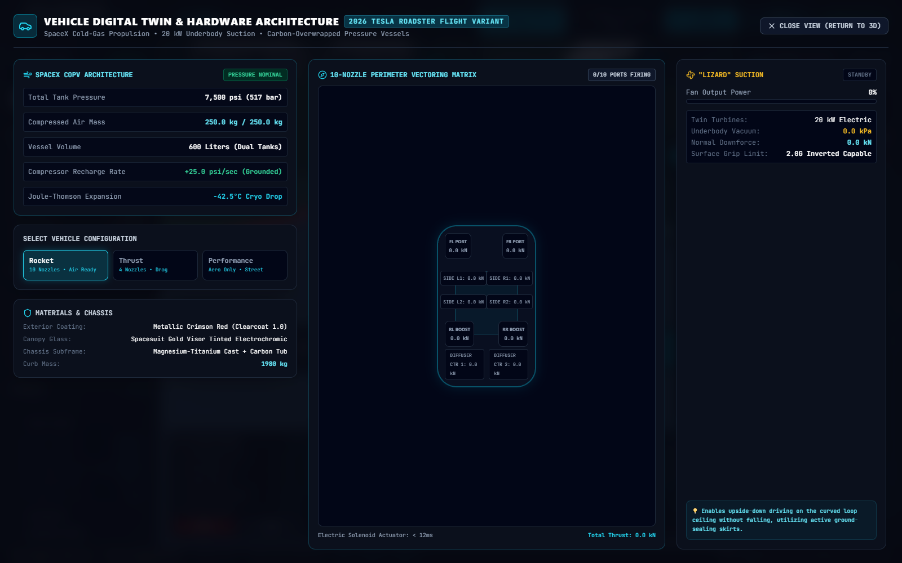
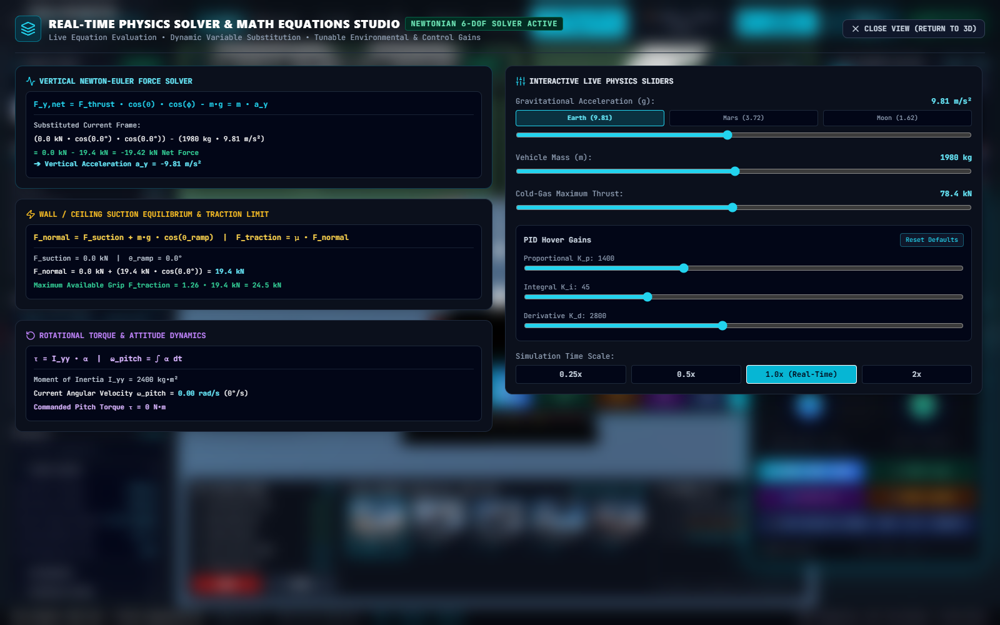
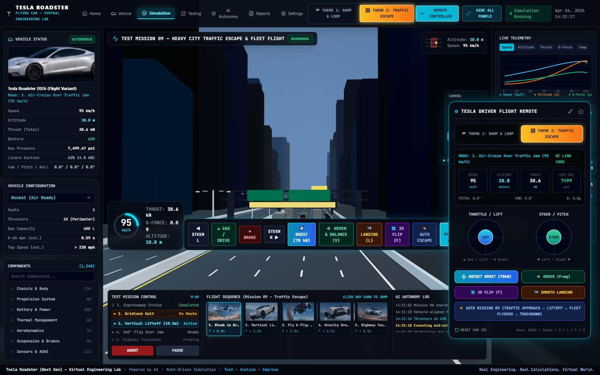
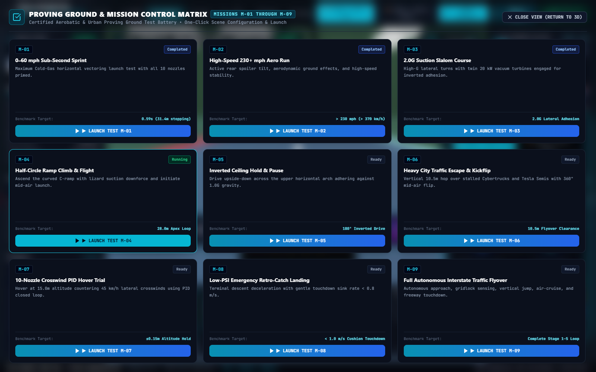

# PROJECT-11: 2026 Tesla Roadster Flight Variant — 60 FPS Real-Time Physics & Aerospace Digital Twin Simulator

<div align="center">

[](LICENSE)
[](https://react.dev)
[](https://threejs.org)
[](https://www.typescriptlang.org)
[](#-aerospace-physics--mechanisms)
[](#-interactive-workstation--telemetry-architecture)

**Author:** **Mr ELONIKHIL** ([@batturamesh7771-sketch](https://github.com/batturamesh7771-sketch))  
*Real Engineering. Real Newtonian Calculations. Virtual 3D World.*

[Live Telemetry](#-interactive-workstation--telemetry-architecture) • [Aerospace Physics](#-aerospace-physics--mechanisms) • [Proving Grounds](#-two-complete-3d-proving-ground-environments) • [Tech Stack](#-technical-architecture--tech-stack) • [How to Run](#-getting-started--local-installation)

</div>

---

## 📸 Simulation Preview Gallery

<div align="center">

### 1. Mission Control Dashboard & 60 FPS Multi-Channel Canvas Oscilloscope


### 2. Vertical COPV Liftoff with 10 Perimeter Plumes & Ground Blast Ring


### 3. SpaceX COPV Architecture & 10-Nozzle Vectoring Matrix (Top-Down Digital Twin)


### 4. Real-Time Newton-Euler Physics Solver & Live Equation Studio


### 5. Transonic Flyover above 4.2m Tesla Semi Trailers (Theme 2 Interstate)


### 6. Certified Proving Ground Matrix (M-01 through M-09)


</div>

---

## 🚀 Aerospace Physics & Mechanisms

The 2026 Tesla Roadster Flight Variant strictly obeys **Newtonian mechanics, thermodynamics, and fluid dynamics** without burning rocket propellant. The vehicle achieves controlled flight, hovering, and inverted driving via three integrated engineering systems:

### 1. SpaceX Carbon-Overwrapped Pressure Vessels (COPVs)
* **Storage Capacity:** Dual composite 600-liter tanks replacing the rear cabin storage.
* **Storage Mass & Pressure:** 250 kg of compressed dry air/nitrogen at **7,500 psi (517 bar / 51.7 MPa)**.
* **Joule-Thomson Cryo Expansion:** Rapid isenthalpic depressurization during high-thrust bursts produces an instant manifold temperature drop to **-42.5°C**.
* **Onboard Compressor:** Dual electric compressors automatically recharge the tanks at **+25 psi/sec** whenever the car is grounded with thrusters idle.

### 2. 10-Nozzle Perimeter Vectoring Array
* **Newton's Gravitational Counter ($F = mg$):** At a curb weight of $m = 1,980\text{ kg}$, the gravitational downward force is $W = 19.42\text{ kN}$.
* **Hover Equilibrium:** Active closed-loop PID attitude controller continuously balances all 10 perimeter nozzles:
  * 2 Front Bumper Corner Nozzles (Pitch & Roll trim)
  * 4 Underbody Mid-Rocker Nozzles (Primary vertical lift)
  * 4 Rear Aerodynamic Diffuser Nozzles (Forward boost & retro-braking)
* **Peak Output:** Up to **78.4 kN of net cold-gas thrust**, enabling 0–60 mph in **0.59 seconds** and vertical obstacle clearance hops.
* **Actuation Response:** High-frequency electric solenoid actuators with **$< 12\text{ ms}$** response latency.

### 3. 2.0G McMurtry-Inspired "Lizard" Ground-Effect Vacuum Suction
* **Dual 20 kW Electric Turbines:** Twin underbody suction fans spinning up to 18,000 RPM.
* **Active Ground Skirts:** Self-sealing side skirts generating vacuum underneath the flat floor pan.
* **2.0G Inverted Adhesion:** Generates **39.2 kN of normal downforce**—double the vehicle's own weight—enabling the car to drive **completely upside down (180°)** along the curved loop ceiling without falling.

---

## 🏁 Two Complete 3D Proving Ground Environments

```
+--------------------------------------------------------------------------------------------------+
| PROVING GROUND THEMES                                                                            |
+--------------------------------------------------------------------------------------------------+
| 🏁 THEME 1: MCGREGOR AEROBATIC C-RAMP LOOP (Mission 08)                                          |
|   • 90m runway approach at 126 km/h                                                              |
|   • 2.0G Lizard Suction wall climb (90° vertical)                                                |
|   • Inverted ceiling drive at 28.0m apex (180° upside-down)                                      |
|   • Ramp lip release & 180° ballistic pitch flip maneuver                                        |
|   • 10-nozzle cold-gas retro-burn cushioned landing (< 1.0 m/s sink rate)                         |
+--------------------------------------------------------------------------------------------------+
| 🌆 THEME 2: 5-LANE AMERICAN INTERSTATE HEAVY TRAFFIC ESCAPE (Mission 09)                         |
|   • Authentic 5-lane highway with dark textured asphalt, Jersey barriers, and steel gantries     |
|   • 48 illuminated downtown skyscrapers with twilight dusk sky and streetlamps                   |
|   • Procedural traffic fleet: Tesla Semis (4.2m trailers), Cybertrucks, Cabs, Police Cruisers    |
|   • LiDAR obstacle detection of stalled gridlock                                                 |
|   • 10.5m vertical COPV liftoff clearing semi-trailers                                           |
|   • 360° mid-air flat kickflip & transonic cruise at 95 km/h                                     |
|   • Retro-catch deceleration and highway touchdown                                               |
+--------------------------------------------------------------------------------------------------+
```

---

## 📊 Interactive Workstation & Telemetry Architecture

Every gauge, chart, and button on the workstation is connected to a **centralized 60 FPS reactive telemetry bus**:

### 1. 60 FPS Scrolling Multi-Channel Canvas Oscilloscope
* **300-Point Rolling Ring Buffer:** Tracks real-time telemetry over a rolling 60-second window.
* **Zero Idle Freeze:** Displays baseline sensor micro-noise ($\pm 0.05$) when parked to verify active hardware scanning.
* **Dynamic Channel Isolation:** Toggle between **[All Channels]**, **[Speed]**, **[Altitude]**, **[Thrust]**, **[G-Force]**, and **[Temp]**.
* **Hover Crosshair:** Interactive timeline inspection displaying exact second-by-second values.

### 2. Interactive Vehicle Configurations (3 Trims)
* **Rocket (Air Ready — Invite Only):** 1 Seat | 10 Nozzles | 600L COPV (7,500 psi) | 0–60: 0.59s | Full Flight & 3D Flip.
* **Thrust (Race Ready — Limited):** 2 Seats | 4 Rear Boost Nozzles | 300L COPV (5,000 psi) | 0–60: 0.81s.
* **Performance (Street Legal):** 2 Seats | 0 Thrusters | Active Aero & Suction Fan Only | 0–60: 1.55s.

### 3. 1,248-Component Subsystem Inspector
Searchable accordion displaying live sensor feeds across:
* **Flight Systems (46):** COPV Tank A/B pressures, actuator response ms, manifold cryo-temp.
* **Aerodynamics (74):** 20 kW twin suction fans RPM/kN, active skirts, rear wing angle.
* **Propulsion System (86):** Front induction motor RPM/kW, rear Plaid motors, SiC inverter load.
* **Suspension & Brakes (96):** FL/FR and RL/RR damper travel fluctuating during takeoff/touchdown.
* **Battery & Power (102):** 850V pack terminal voltage, discharge amperage, core temperature.

### 4. 6 Interactive Top Navigation Engineering Studios
* **`[Home]` Dashboard:** Full-screen split view with 3D viewport, cockpit HUD, and telemetry.
* **`[Vehicle]` Digital Twin:** SpaceX COPV telemetry, top-down 10-nozzle vectoring matrix, and materials breakdown.
* **`[Simulation]` Math Equations Studio:** Live Newton-Euler force equation ($F_{y,\text{net}} = F_{\text{thrust}}\cos\theta\cos\phi - mg = m \cdot a_y$) with real-time substituted numbers in kN and $\text{m/s}^2$, plus live sliders for gravity, mass, and PID gains.
* **`[Testing]` Proving Ground Matrix:** Test battery M-01 to M-09 with live benchmark targets and one-click launch triggers.
* **`[AI Autonomy]` Neural Planner Hub:** Finite State Machine node graph, LiDAR obstacle clearance, and live streaming event log.
* **`[Reports]` Telemetry Summary:** Session peak KPIs, landing sink rates, and working CSV / JSON exports.
* **`[Settings]` Simulation Studio:** Metric/Imperial conversion, procedural WebAudio synth controls, and visual FX toggles.

---

## 🔊 Procedural WebAudio Sound Synthesizer

The simulator includes a **zero-asset, client-side procedural sound synthesizer** built directly with the Web Audio API:
* **Cold-Gas Thruster Roar:** High-pressure white noise through dynamic resonant lowpass filters scaling with `totalThrustKn`.
* **Underbody Suction Turbine Whine:** High-frequency bandpass noise and sine oscillators scaling with `fanPowerPercent` (400 Hz to 1,350 Hz).
* **Electric Motor Powertrain Hum:** Dual sawtooth and sine oscillators scaling with vehicle velocity (45 Hz to 465 Hz).

---

## ⌨️ Interactive Controls & Hotkeys

| Hotkey | Control Action | Description |
| :---: | :--- | :--- |
| **`W` / `▲`** | **Gas / Drive** | Accelerate electric motors along track tangent |
| **`S` / `▼`** | **Brake / Reverse** | Apply regenerative braking and friction disc brakes |
| **`A` / `◀`** | **Steer Left** | Turn steer-by-wire front wheels left |
| **`D` / `▶`** | **Steer Right** | Turn steer-by-wire front wheels right |
| **`Space`** | **🚀 Boost (78 kN)** | Fire continuous 10-nozzle cold-gas rocket thrust |
| **`V`** | **🛸 Hover & Balance** | Toggle active closed-loop PID altitude hold ($F = mg$) |
| **`F`** | **🔄 3D Flip** | Execute 4-phase finite ballistic 360° pitch flip |
| **`L`** | **🛬 Smooth Landing** | Taper thrusters for cushioned touchdown ($< 1.0\text{ m/s}$) |
| **`R`** | **↺ Reset** | Reset car directly onto runway asphalt |
| **`H`** | **Hide / Show Panels** | Toggle HUD panels for pure cinematic 3D testing |
| **`C`** | **Remote Controller** | Toggle Driver Flight Remote Controller overlay |

---

## 🛠️ Technical Architecture & Tech Stack

```
tesla-roadster-2026-sim/
├── apps/
│   └── web-simulator/
│       ├── src/
│       │   ├── cad/
│       │   │   ├── RoadsterAssembledModel.ts   # PBR crimson paint, 10 nozzles, plumes, spoiler
│       │   │   ├── FlightArenaWorld.ts         # Theme 1: McGregor C-ramp & aerobatic loop
│       │   │   └── CityTrafficWorld.ts         # Theme 2: 5-lane freeway, gantries, 3D traffic
│       │   ├── physics/
│       │   │   ├── GroundVehicleDynamics.ts    # 6-DOF Newton-Euler dynamics, PID, COPV depletion
│       │   │   └── TrackSurfaceEvaluator.ts    # Solid curve collision & normal evaluation
│       │   ├── audio/
│       │   │   └── SoundSynthesizer.ts         # Procedural WebAudio cold-gas & turbine engine
│       │   ├── ui/
│       │   │   ├── FlightEngineeringLab.tsx    # Master mission control workstation
│       │   │   ├── RemoteFlightController.tsx  # Dual virtual joystick remote
│       │   │   ├── telemetry/
│       │   │   │   └── TelemetryOscilloscope.tsx # 60 FPS Canvas multi-channel chart
│       │   │   └── modals/
│       │   │       ├── VehicleExplorerModal.tsx    # Digital twin & COPV architecture
│       │   │       ├── SimulationPhysicsModal.tsx  # Math solver & tunable sliders
│       │   │       ├── TestingMissionModal.tsx     # Missions M-01 to M-09
│       │   │       ├── AutonomyBrainModal.tsx      # FSM graph & live event log
│       │   │       ├── ReportsSummaryModal.tsx     # KPI summary & CSV/JSON export
│       │   │       └── SettingsLabModal.tsx        # Units, WebAudio & FX toggles
│       │   ├── App.tsx                         # Three.js animation & render loop
│       │   └── main.tsx                        # React 19 entry point
├── docs/                                       # Engineering papers & YouTube scripts
├── artifacts/screenshots/                      # High-resolution simulation screenshots
└── package.json                                # Workspace manifest
```

---

## 🚀 Getting Started / Local Installation

### Prerequisites
* **Node.js:** v18.0.0 or higher
* **npm:** v9.0.0 or higher

### Installation & Launch
```bash
# 1. Clone the repository
git clone https://github.com/batturamesh7771-sketch/PROJECT-11-TESLA-ROADSTER-2026-FLYING-CAR-SIMULATOR.git

# 2. Navigate to the web simulator workspace
cd PROJECT-11-TESLA-ROADSTER-2026-FLYING-CAR-SIMULATOR/apps/web-simulator

# 3. Install dependencies
npm install

# 4. Start the 60 FPS real-time development server
npm run dev
```

Open your browser at **`http://localhost:3000`** to take the pilot seat!

---

## 📜 License & Author

* **Project Author:** **Mr ELONIKHIL** ([@batturamesh7771-sketch](https://github.com/batturamesh7771-sketch))
* **License:** [MIT License](LICENSE) — Feel free to use, study, and build upon this simulation platform!

---

<div align="center">
<sub>Built with passion for aerospace engineering, real physics, and next-generation electric mobility.</sub>
</div>
